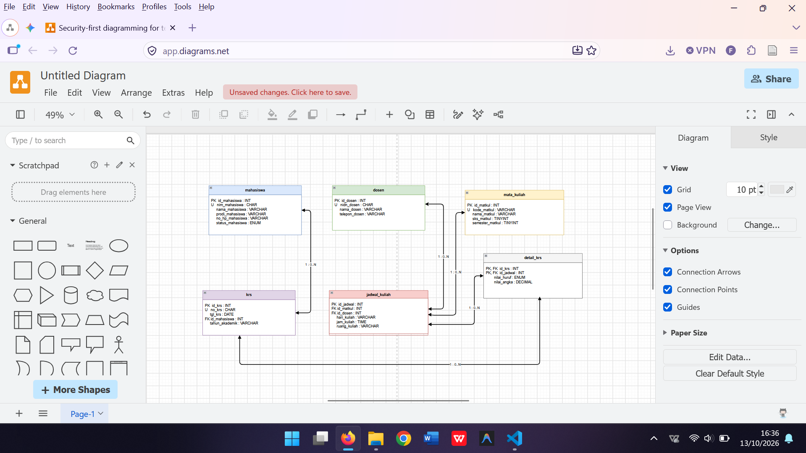
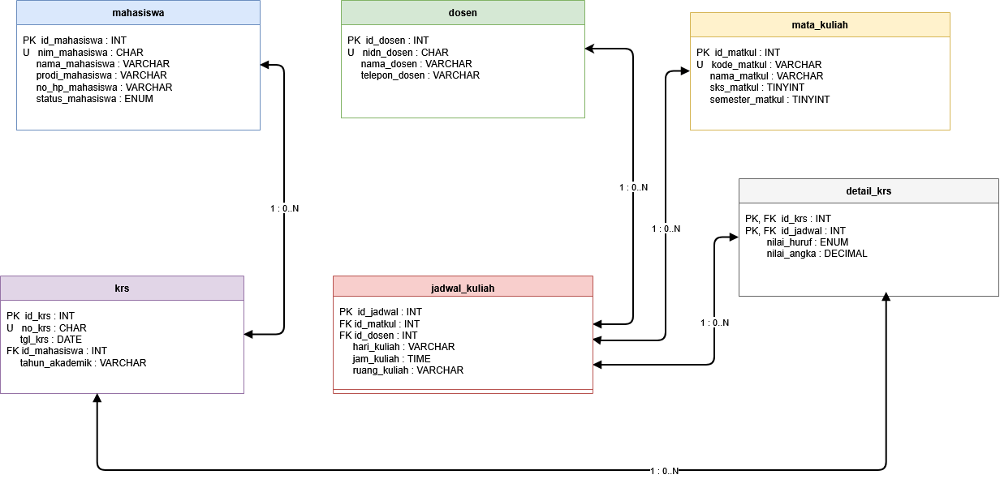
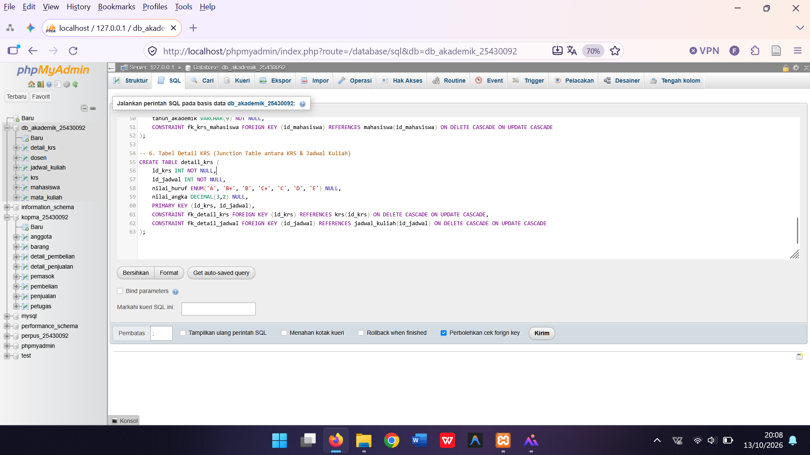
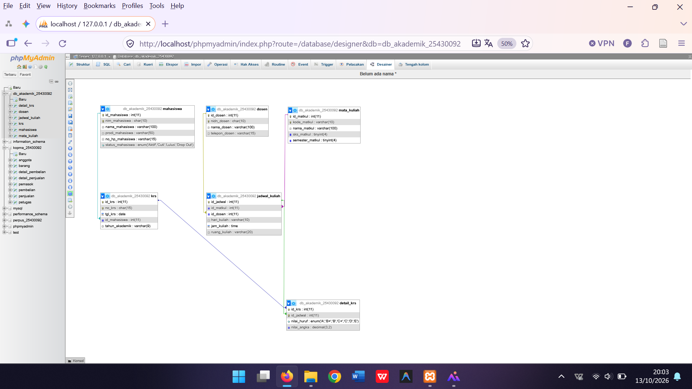

cat << 'EOF' > laporan/p03_laporan_25430092.md
# Laporan Praktikum Basis Data - Modul 3

**Nama:** M. Fakta Kusuma  
**NIM:** 25430092  
**Kelas:** D  
**Tanggal:** 13 Oktober 2026  

---

## 1. Tujuan Praktikum
1. Mampu merancang dan menerjemahkan model konseptual serta logis basis data ke dalam bentuk **Basis Data Fisik (Physical Database)** menggunakan MySQL / MariaDB pada antarmuka phpMyAdmin secara akurat.
2. Mampu menyusun struktur DDL (*Data Definition Language*) SQL yang lengkap dengan spesifikasi tipe data presisi, *Primary Key*, *Unique Constraint*, serta pembatasan integritas data yang ketat.
3. Mampu menerapkan batasan relasional (*Foreign Key*) dengan aksi referensial dinamis seperti `ON DELETE CASCADE` dan `ON UPDATE CASCADE` guna menjaga konsistensi referensial antar entitas tabel.
4. Mampu memverifikasi hasil implementasi fisik melalui tampilan **Desainer phpMyAdmin** serta melakukan dokumentasi struktur basis data secara sistematis dan komprehensif.

---

## 2. Ringkasan Landasan Teori

Perancangan basis data fisik (*physical database design*) merupakan tahapan translasi krusial yang menjembatani model konseptual dan logis ke dalam implementasi sistem manajemen basis data relasional (*RDBMS*) yang sesungguhnya. Pada tahap ini, seluruh entitas abstrak ditransformasikan ke dalam bentuk tabel fisik di dalam memori penyimpanan sekunder, lengkap dengan definisi kolom, pemilihan tipe data yang efisien (*data types optimization*), penentuan kunci utama (*Primary Key*), serta pembatasan aturan integritas (*integrity constraints*).

Penerapan *Foreign Key* dengan aksi referensial komplementer seperti `ON DELETE CASCADE` dan `ON UPDATE CASCADE` memiliki peranan yang sangat vital. Mekanisme ini memastikan bahwa setiap perubahan atau penghapusan data pada tabel induk (*parent table*) akan secara otomatis disinkronkan ke tabel anak (*child table*), sehingga secara efektif mampu mencegah munculnya fenomena *orphan record* (data yatim yang kehilangan relasi referensialnya). 

Selain itu, dalam pemodelan relasional tingkat lanjut, hubungan kardinalitas *Many-to-Many* ($M:N$) antar entitas wajib diselesaikan menggunakan perantara tabel penghubung (*junction table* atau *associative table*) yang mengimplementasikan *Composite Primary Key* (gabungan dua kunci asing dari tabel yang berelasi).

---

## 3. Hasil Langkah Percobaan & Analisis Proyek Akademik ($P = 3$)

Praktikum kali ini melanjutkan pengembangan proyek sistem informasi akademik dengan menggunakan parameter personal $P = 3$. Parameter ini diturunkan berdasarkan perhitungan dua digit terakhir NIM mahasiswa ($\text{NIM} = 25430092 \rightarrow 92$), di mana $P = (92 \bmod 9) + 1 = 3$. 

### A. Spesifikasi Entitas & Skema Relasi Fisik:
Basis data fisik yang dibangun dan diinisialisasi diberi nama `db_akademik_25430092` yang menaungi 6 tabel utama dengan rincian fungsional sebagai berikut:
1. **Tabel `mahasiswa`**: Berfungsi untuk menyimpan data identitas lengkap mahasiswa, dilengkapi dengan nomor induk mahasiswa (`nim_mahasiswa`) yang bersifat unik, program studi, kontak, serta status akademik mahasiswa menggunakan tipe data terstruktur `ENUM`.
2. **Tabel `dosen`**: Berfungsi untuk menyimpan rekam jejak tenaga pengajar atau dosen berdasarkan nomor induk dosen nasional (`nidn_dosen`) serta informasi kontak pendukung.
3. **Tabel `mata_kuliah`**: Menyimpan katalog daftar mata kuliah yang ditawarkan, lengkap dengan kode unik mata kuliah, bobot Satuan Kredit Semester (`sks_matkul`), serta penempatan semester akademik.
4. **Tabel `jadwal_kuliah`**: Bertindak sebagai tabel entitas terikat yang menghubungkan mata kuliah dengan dosen pengampu, disertai informasi waktu pelaksanaan (`hari_kuliah`, `jam_kuliah`) dan alokasi ruang kelas (`ruang_kuliah`).
5. **Tabel `krs`**: Menyimpan dokumen header Kartu Rencana Studi mahasiswa pada periode tahun akademik tertentu yang terikat langsung dengan data mahasiswa.
6. **Tabel `detail_krs`**: Merupakan tabel perantara (*junction table*) berelasi *Many-to-Many* yang menjembatani entitas `krs` dan `jadwal_kuliah`, serta menampung komponen evaluasi nilai akhir mahasiswa berupa nilai huruf dan nilai angka.

---

## 4. Dokumentasi Implementasi Fisik & Visualisasi

### A. Perancangan & Pengeditan ERD di Draw.io
Tahapan awal sebelum implementasi fisik dilakukan dengan menyusun dan merancang model relasional entitas sistem akademik secara visual melalui aplikasi pemodelan diagram **draw.io**:

  
*Keterangan: Proses penyusunan entitas, atribut, dan relasi tabel akademik di aplikasi diagram.*

---

### B. Physical Entity Relationship Diagram (ERD) Final
Berikut adalah hasil akhir diagram ERD fisik yang menggambarkan struktur tabel secara utuh, atribut kunci, serta garis kardinalitas referensial antar entitas:

  
*Keterangan: Tinjauan akhir diagram ERD fisik yang menghubungkan seluruh tabel sistem akademik secara proporsional.*

---

### C. Eksekusi Script SQL DDL di phpMyAdmin
Penerapan perintah *Data Definition Language* (DDL) untuk mengonstruksi basis data `db_akademik_25430092` beserta seluruh skema tabel relasional pendukungnya dieksekusi langsung melalui konsol SQL phpMyAdmin:

  
*Keterangan: Eksekusi kode DDL pembuatan database dan skema tabel relasional akademik.*

---

### D. Verifikasi Tampilan Desainer phpMyAdmin
Hasil verifikasi tata letak akhir (*layout*) pada fitur **Desainer phpMyAdmin** menunjukkan bahwa seluruh garis relasi penghubung antar kunci asing (*Foreign Key*) telah terjalin dengan rapi, konsisten, dan memenuhi kaidah normalisasi basis data:

  
*Keterangan: Tampilan visual skema relasional di Desainer phpMyAdmin yang mengonfirmasi integritas referensial berjalan sempurna.*

---

## 5. Pembahasan dan Analisis Kendala

Dalam proses implementasi fisik perancangan basis data akademik ini, terdapat beberapa aspek teknis dan kendala yang dijumpai serta berhasil diselesaikan:
1. **Kesesuaian Tipe Data Penghubung (*Foreign Key*):** Kendala awal yang sering ditemui adalah potensi ketidakcocokan tipe data antara kolom kunci asing di tabel anak dengan kunci utama di tabel induk. Hal ini diatasi secara cermat dengan memastikan bahwa seluruh kolom referensi menggunakan tipe data numerik `INT` yang identik agar tidak memicu galat integritas saat proses *constraint binding*.
2. **Penerapan Aksi Referensial (*Cascade*):** Pengaturan aksi `ON DELETE CASCADE` dan `ON UPDATE CASCADE` diuji secara ketat untuk memastikan integritas data tetap terjaga ketika terjadi perubahan atau penghapusan data induk tanpa meninggalkan sampah data (*orphan records*) di dalam sistem.

---

## 6. Kesimpulan

1. Seluruh 6 entitas tabel perancangan sistem informasi akademik berhasil diimplementasikan secara fisik ke dalam lingkungan RDBMS MySQL / MariaDB dengan nama basis data `db_akademik_25430092`.
2. Kompleksitas hubungan data bertipe *Many-to-Many* antara dokumen Kartu Rencana Studi (`krs`) dan `jadwal_kuliah` sukses diselesaikan secara elegan melalui tabel perantara `detail_krs`.
3. Verifikasi visual menggunakan fitur Desainer phpMyAdmin membuktikan bahwa seluruh batasan integritas data, kunci primer, dan kunci asing telah berfungsi secara optimal dan akurat.

---

## 7. Pernyataan Penggunaan AI

Dalam penyusunan dan perumusan laporan praktikum ini, kecerdasan buatan (*Artificial Intelligence*) dimanfaatkan secara bijak sebagai asisten pendukung untuk:
1. Menyusun kerangka struktur penulisan laporan berbasis Markdown agar sistematis, rapi, dan mudah dibaca.
2. Memvalidasi konsistensi tata bahasa serta penjelasan landasan teoretis perancangan basis data fisik.

Seluruh rangkaian proses perancangan ERD, eksekusi perintah DDL di phpMyAdmin, pengujian relasi, pengambilan tangkapan layar, hingga proses sinkronisasi kode dikerjakan secara mandiri.

---

## 8. Bukti Git & Manajemen Repositori

- **Nama Repositori GitHub:** `akademik_092`
- **Lokasi Berkas Laporan:** `laporan/p03_laporan_25430092.md`
- **Format Pesan Commit:** `p03: finalisasi laporan lengkap komprehensif tanpa kode sql`
EOF