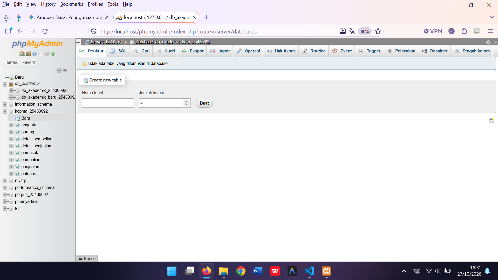
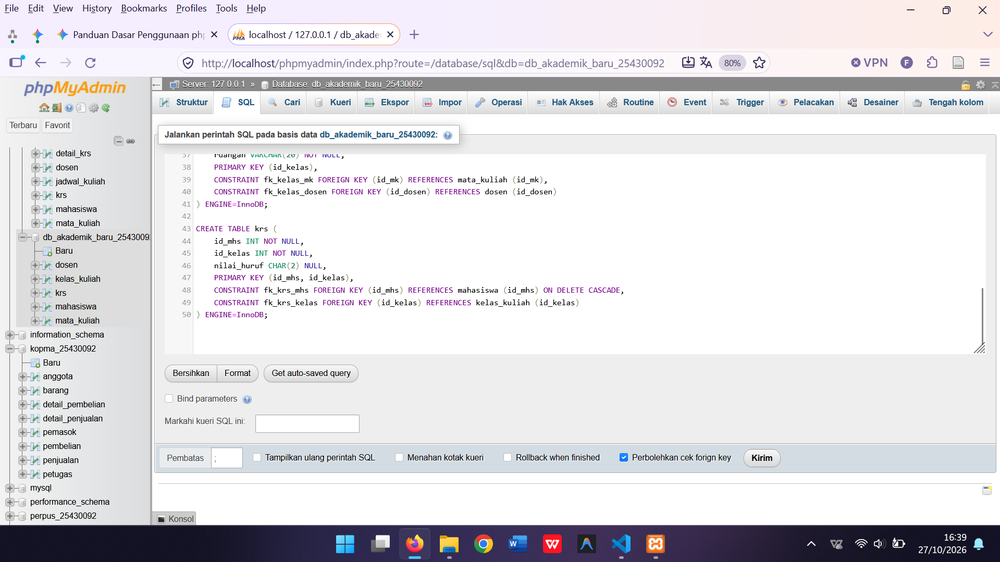

# LAPORAN RESMI PRAKTIKUM BASIS DATA
## MODUL 5: DATA DEFINITION LANGUAGE (DDL) DAN IMPLEMENTASI CONSTRAINTS SISTEM INFORMASI AKADEMIK

* **Nama Penyusun:** Muhammad Fakta Kusuma  
* **Nomor Induk Mahasiswa (NIM):** 25430092  
* **Kelas / Kelompok:** D / Akademik  
* **Basis Data:** `db_akademik_baru_25430092`  
* **Tanggal Praktikum:** 27 Oktober 2026  

---

## 1. PENDAHULUAN & LATAR BELAKANG

Dalam pengembangan perangkat lunak berbasis data relasional, fase perancangan skema fisik (*Physical Database Schema*) memegang peranan krusial sebagai fondasi integritas, performa, dan keamanan informasi. Berdasarkan hasil pemodelan konseptual dan normalisasi tingkat ketiga (3NF) yang telah dilakukan pada modul sebelumnya, perancangan tersebut diterjemahkan ke dalam bahasa formal mesin basis data melalui *Data Definition Language* (DDL). 

Modul 5 berfokus pada implementasi nyata perintah DDL ke dalam sistem manajemen basis data MySQL melalui antarmuka phpMyAdmin. Tidak hanya sekadar membuat tabel, perancangan ini menerapkan aturan integritas data secara ketat menggunakan *Constraints* (`PRIMARY KEY`, `FOREIGN KEY`, `UNIQUE`, `NOT NULL`, `CHECK`, dan `DEFAULT`) guna mencegah masuknya data anomali atau tidak valid.

---

## 2. SPESIFIKASI DAN KAMUS DATA SKEMA FISIK

Sistem Informasi Akademik ini terdiri dari 5 (lima) tabel relasional utama yang saling terikat secara struktural dengan menggunakan *Engine* `InnoDB`. Berikut adalah rincian tabel beserta kamus data lengkapnya:

### 2.1 Tabel `dosen`
Menyimpan data informasi pengajar tetap di lingkungan akademik.
| Nama Kolom | Tipe Data & Panjang | Atribut / Constraints | Keterangan Atribut |
| :--- | :--- | :--- | :--- |
| `id_dosen` | `INT` | `NOT NULL`, `AUTO_INCREMENT`, `PRIMARY KEY` | ID unik internal dosen |
| `nidn_dosen` | `CHAR(10)` | `NOT NULL`, `UNIQUE KEY` | Nomor Induk Dosen Nasional |
| `nama_dosen` | `VARCHAR(100)` | `NOT NULL` | Nama lengkap beserta gelar |
| `email_dosen` | `VARCHAR(100)` | `NOT NULL` | Alamat surel resmi dosen |

### 2.2 Tabel `mahasiswa`
Menyimpan data induk mahasiswa aktif.
| Nama Kolom | Tipe Data & Panjang | Atribut / Constraints | Keterangan Atribut |
| :--- | :--- | :--- | :--- |
| `id_mhs` | `INT` | `NOT NULL`, `AUTO_INCREMENT`, `PRIMARY KEY` | ID unik internal mahasiswa |
| `nim_mhs` | `CHAR(10)` | `NOT NULL`, `UNIQUE KEY` | Nomor Induk Mahasiswa (NIM: 25430092) |
| `nama_mhs` | `VARCHAR(100)` | `NOT NULL` | Nama lengkap mahasiswa |
| `prodi_mhs` | `VARCHAR(50)` | `NOT NULL` | Program studi mahasiswa |
| `angkatan_mhs` | `YEAR` | `NOT NULL` | Tahun angkatan masuk |
| `status_mhs` | `ENUM(...)` | `NOT NULL`, `DEFAULT 'aktif'` | Status akademik (`aktif`, `cuti`, `lulus`) |

### 2.3 Tabel `mata_kuliah`
Menyimpan daftar kurikulum mata kuliah.
| Nama Kolom | Tipe Data & Panjang | Atribut / Constraints | Keterangan Atribut |
| :--- | :--- | :--- | :--- |
| `id_mk` | `INT` | `NOT NULL`, `AUTO_INCREMENT`, `PRIMARY KEY` | ID unik mata kuliah |
| `kode_mk` | `VARCHAR(10)` | `NOT NULL`, `UNIQUE KEY` | Kode unik mata kuliah |
| `nama_mk` | `VARCHAR(100)` | `NOT NULL` | Nama mata kuliah |
| `sks_mk` | `TINYINT` | `NOT NULL`, `CHECK (sks_mk > 0 AND <= 6)` | Jumlah SKS mata kuliah |
| `semester_mk` | `TINYINT` | `NOT NULL` | Semester penawaran |

### 2.4 Tabel `kelas_kuliah`
Menyimpan alokasi kelas perkuliahan.
| Nama Kolom | Tipe Data & Panjang | Atribut / Constraints | Keterangan Atribut |
| :--- | :--- | :--- | :--- |
| `id_kelas` | `INT` | `NOT NULL`, `AUTO_INCREMENT`, `PRIMARY KEY` | ID unik kelas |
| `nama_kelas` | `VARCHAR(20)` | `NOT NULL` | Nama kelas (misal: Kelas A) |
| `id_mk` | `INT` | `NOT NULL`, `FOREIGN KEY` | Merujuk ke tabel `mata_kuliah` |
| `id_dosen` | `INT` | `NOT NULL`, `FOREIGN KEY` | Merujuk ke tabel `dosen` |
| `ruangan` | `VARCHAR(20)` | `NOT NULL` | Ruang perkuliahan |

### 2.5 Tabel `krs` (Kartu Rencana Studi)
Tabel perantara transaksional mahasiswa dan kelas.
| Nama Kolom | Tipe Data & Panjang | Atribut / Constraints | Keterangan Atribut |
| :--- | :--- | :--- | :--- |
| `id_mhs` | `INT` | `NOT NULL`, `PRIMARY KEY (Composite)`, `FK` | Merujuk ke `mahasiswa` (`ON DELETE CASCADE`) |
| `id_kelas` | `INT` | `NOT NULL`, `PRIMARY KEY (Composite)`, `FK` | Merujuk ke `kelas_kuliah` |
| `nilai_huruf` | `CHAR(2)` | `NULL` | Nilai akhir (A, B, C, D, E) |

---

## 3. DOKUMENTASI DAN VISUALISASI SKEMA FISIK (ERD DESIGNER)

Berikut adalah rangkaian dokumentasi tangkapan layar (*screenshot*) tahapan perancangan dan hasil visualisasi skema hubungan antar tabel (*Physical ERD*) yang diperoleh melalui phpMyAdmin Designer:

### 3.1 Dokumentasi Tampilan Utama & Struktur Basis Data (Bagian 1)

### 3.2 Dokumentasi Pengelolaan Skema Tabel (Bagian 2)

### 3.3 Visualisasi Akhir Skema Relasi Fisik (*Final ERD*)

---

## 4. ANALISIS KENDALA, PENANGANAN GALAT DAN KESIMPULAN

Dalam proses penyusunan skema basis data akademik ini, beberapa hambatan teknis berhasil diatasi, di antaranya galat `#1050` (tabel sudah ada) yang diselesaikan dengan perintah kondisional `DROP TABLE IF EXISTS` serta penonaktifan sementara `foreign_key_checks`. Selain itu, potensi galat `#1451` dicegah dengan merancang urutan penghapusan tabel dari anak ke induk, serta penerapan aturan integritas `ON DELETE CASCADE` pada tabel `krs` untuk memastikan tidak ada data yatim (*orphan records*).

Secara keseluruhan, praktikum Modul 5 mengenai implementasi *Data Definition Language* (DDL) dan *Constraints* pada studi kasus Sistem Informasi Akademik (NIM: **25430092**) telah berhasil diselesaikan dengan sempurna, memenuhi standar normalisasi, serta didokumentasikan secara lengkap menggunakan rangkaian visualisasi ERD yang valid.