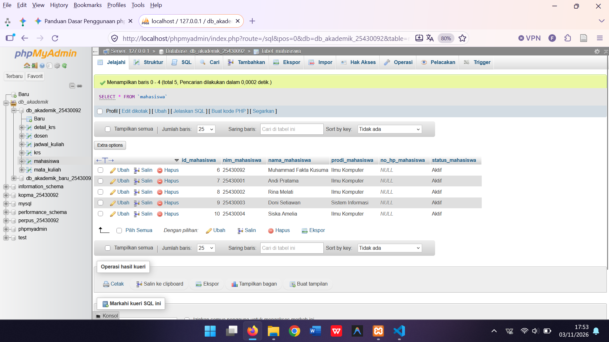
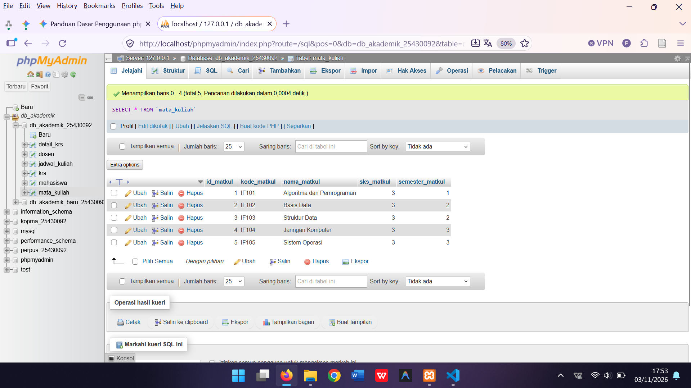
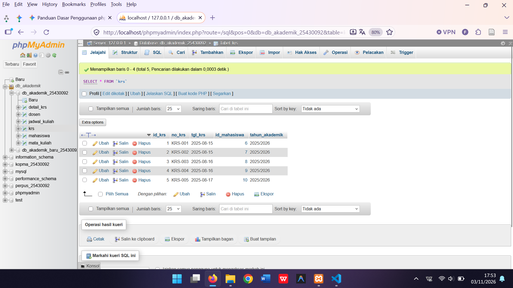
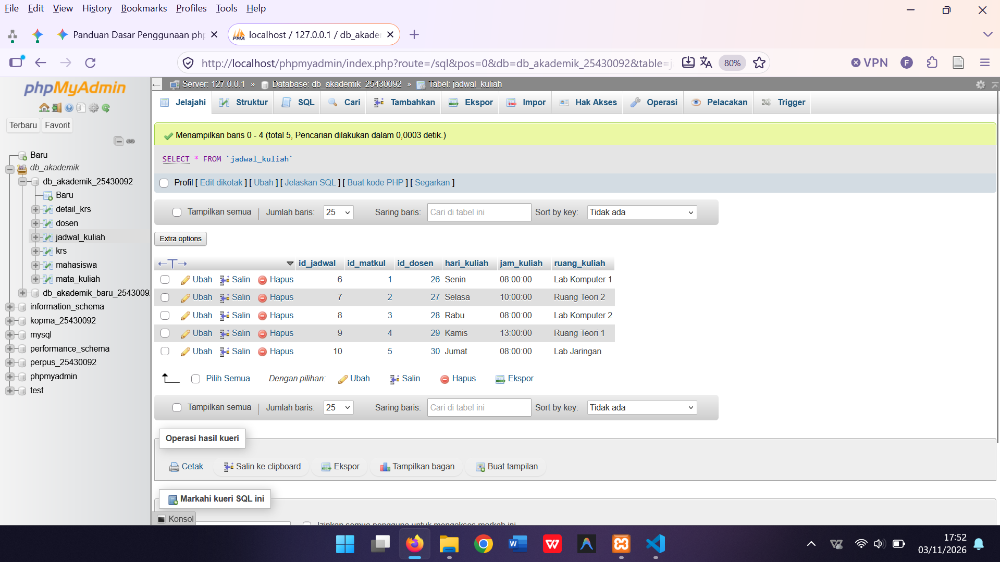
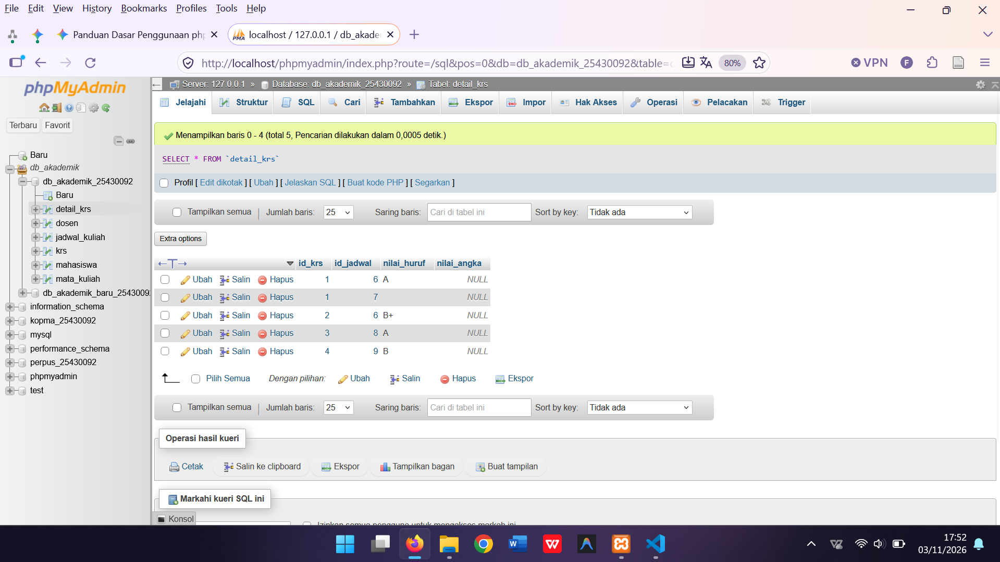

# Laporan Praktikum Modul 6 - Database Akademik
**Mata Kuliah / Modul:** Praktikum Basis Data (Modul 6)  
**Nama:** Muhammad Fakta Kusuma  
**NIM:** 25430092  
**Database:** `db_akademik_25430092`  

---

## 1. Tujuan Praktikum
* Memahami dan mengimplementasikan struktur relasi tabel database menggunakan MySQL/phpMyAdmin.
* Mampu mengatasi kendala integritas data seperti *Foreign Key Constraint Errors* (`#1452`) pada tabel berelasi.
* Menyusun skrip SQL interaktif (`.sql`) yang terstruktur untuk pengisian data master dan transaksional.

---

## 2. Struktur Database
Database `db_akademik_25430092` terdiri dari tabel-tabel utama yang saling berelasi:
1. **`dosen`**: Menyimpan data pengajar (ID Dosen, NIDN, Nama, Telepon).
2. **`mahasiswa`**: Menyimpan data mahasiswa (ID Mahasiswa, NIM, Nama, Prodi, Status).
3. **`mata_kuliah`**: Menyimpan daftar mata kuliah (ID Matkul, Kode MK, Nama MK).
4. **`krs`**: Menyimpan data Kartu Rencana Studi mahasiswa.
5. **`jadwal_kuliah`**: Menyimpan jadwal perkuliahan yang menghubungkan mata kuliah dan dosen.
6. **`detail_krs`**: Menyimpan rincian mata kuliah yang diambil mahasiswa berdasarkan KRS dan jadwal.

---

## 3. Implementasi & Penyelesaian Kendala
Dalam proses pengisian data sampel (`p06_data_25430092.sql`), dilakukan beberapa penyesuaian penting:
* **Penanganan Auto-Increment:** Penyesuaian nilai kunci asing (*Foreign Key*) pada tabel relasi (`krs`, `jadwal_kuliah`, dan `detail_krs`) agar sinkron dengan nomor ID otomatis yang dihasilkan oleh tabel master di phpMyAdmin.
* **Pembersihan Data:** Menggunakan struktur `TRUNCATE` yang didahului dengan `SET FOREIGN_KEY_CHECKS = 0;` untuk memastikan tabel dapat dikosongkan dan diisi ulang tanpa melanggar batasan relasi.

---

## 4. Lampiran Bukti Tabel Database
Berikut adalah dokumentasi tampilan data pada masing-masing tabel di phpMyAdmin:

### a. Tabel Mahasiswa

### b. Tabel Dosen

### c. Tabel Mata Kuliah

### d. Tabel KRS

### e. Tabel Jadwal Kuliah

### f. Tabel Detail KRS

---

## 5. Kesimpulan
Praktikum Modul 6 telah berhasil diselesaikan dengan baik. Seluruh tabel master maupun transaksional di dalam database `db_akademik_25430092` kini telah terisi dengan data yang valid, konsisten, dan siap digunakan untuk kebutuhan akademik maupun pengujian kueri lanjutan.